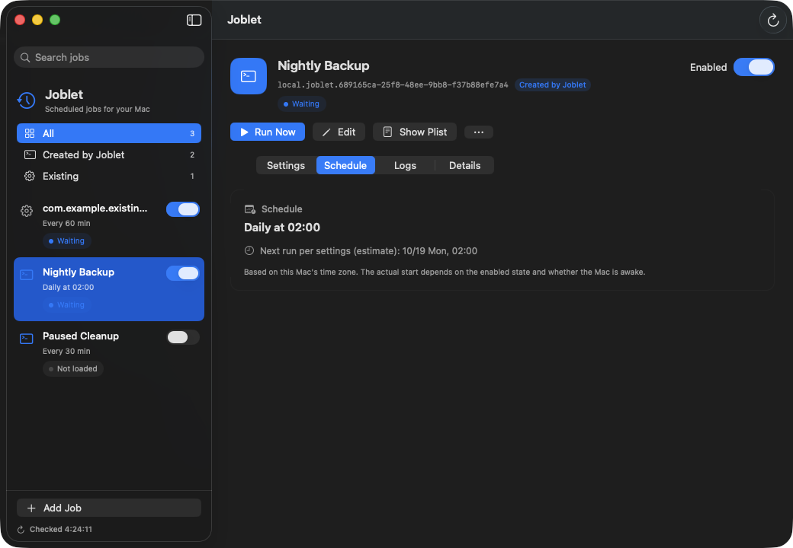

# Joblet

A small SwiftUI app for managing scheduled jobs on your Mac. Joblet is a front end for `launchd`: it creates, edits, enables, disables and runs the LaunchAgents in `~/Library/LaunchAgents`, and ships an MCP server so AI agents can do the same under explicit, opt-in permissions.

Quit the app and your jobs keep running, because macOS runs them.



## Features

- List, search and filter jobs (all / created by Joblet / existing), with running / waiting / not loaded / unknown state.
- Create jobs with an interval, daily, weekly, one-time or manual-only schedule; edit and delete jobs created by Joblet.
- Organize any job, including existing LaunchAgents, into named groups shown as sidebar sections. Groups are stored in `~/Library/Application Support/Joblet/groups.json`; plists are never changed.
- Enable, disable and run now. Read the tail of stdout/stderr and the plist (show or copy).
- Menu bar extra with job status and next run.
- Optional launch at login (Settings), using macOS Login Items.
- Automatic update checks and **Check for Updates…** via Sparkle.
- `joblet-mcp`: a stdio MCP server (see below).

Jobs from other apps can be viewed, and enabled, disabled or run when they can be identified safely. They are never edited or deleted.

## Requirements

macOS 14 or later. Building from source needs Xcode 26.

## Install

```bash
brew install --cask mkusaka/tap/joblet
```

Or download `Joblet.zip` from [GitHub Releases](https://github.com/mkusaka/joblet/releases). The MCP server is bundled at `Joblet.app/Contents/Helpers/joblet-mcp`.

## Build and run

Open `Joblet.xcodeproj` in Xcode, choose the **Joblet** scheme and **My Mac**, then press Run. Or from a terminal:

```bash
scripts/build-app.sh
open build/Build/Products/Release/Joblet.app
```

The build is for your own Mac (ad-hoc signed, App Sandbox off, no notarization). Opening the app changes nothing by itself.

## How scheduling maps to launchd

| Schedule | Plist value |
| --- | --- |
| Every N minutes | `StartInterval = N * 60` |
| Daily at HH:mm | `StartCalendarInterval` with `Hour`, `Minute` |
| Weekly | the above plus `Weekday` (0 = Sunday) |
| Once at a date and time | `StartCalendarInterval` with `Month`, `Day`, `Hour`, `Minute`, plus a wrapper that removes the job after it runs |
| Manual only | no time trigger |
| Also run when loaded | `RunAtLoad = true` |

The command runs through `/bin/zsh -c` with an explicit `PATH` (`/opt/homebrew/bin:/usr/local/bin:/usr/bin:/bin:/usr/sbin:/sbin`); your interactive `.zshrc` is not read. Use absolute paths for tools installed elsewhere, and do not put secrets in the command: it is stored in the plist.

- Enable is `launchctl enable` plus `bootstrap` when needed. Disable is `disable` plus `bootout`.
- Run now is `kickstart -p`; Joblet never force-kills a job (`-k`).
- Calendar jobs missed during sleep run on wake; nothing runs while the Mac is off. Interval jobs are not guaranteed to run during sleep.
- The next-run time shown is an estimate. Calendar jobs derive it from the rule. launchd does not report when an interval job last ran, so Joblet uses the newest write to the job's stdout/stderr log plus the interval, shows "due now" when that time has passed (for example after sleep), and shows nothing for a disabled job or one that has never written to its log.

### One-time jobs

launchd has no year field, so a one-time job runs through a fixed wrapper instead of your command directly:

```
/bin/zsh -c '<wrapper>' joblet-once <YYYY-MM-DDTHH:MM> <your command>
```

The wrapper runs your command in a child `/bin/zsh -c`, logs its exit status to stdout, then runs `launchctl disable` and `launchctl bootout` on its own label, so it neither fires again in this session nor loads at the next login. Your command is passed as a separate argument and never pasted into the wrapper text. If the job fires in a different year than its date, the wrapper skips the command and only removes itself.

- The date must be in the future when you save or enable the job. A job that has run shows **Done**; to run it again, edit it and choose a new date.
- If the Mac is asleep at that time, the job runs on wake. If the Mac is off, the run is missed, and Joblet points that out.
- Run now on a pending one-time job runs it and removes it, the same as the scheduled run.
- "Also run when loaded" is not available for one-time jobs, because the job would run and remove itself as soon as it is loaded.

Created jobs get the label `local.joblet.<UUID>` (not editable). Logs live under `~/Library/Application Support/Joblet/Logs/<label>/`, and a backup of the previous plist is kept there on every edit or delete.

## Safety rules and limitations

- Current user's LaunchAgents only: no LaunchDaemons, other users, or crontab.
- A running job cannot be edited, disabled or deleted. Edits and deletes are refused when the plist changed since it was read, when labels are duplicated, when the plist is a symlink or has unsafe owner/permissions/hard links, when the loaded plist path differs, or when launchctl state cannot be determined. A failed change is rolled back where possible.
- Plists with keys the editor cannot preserve are view/run-only.
- Logs show only the last 64 KiB. There is no run history, rotation or failure notification.
- The exit code is launchd's last reported value, not a run history.
- macOS Background Items approval is separate from launchctl registration; check System Settings if a job is blocked.
- Enabling a job with `RunAtLoad` may run it immediately.

## MCP server

`joblet-mcp` lets AI agents operate jobs over stdio, read-only by default. Build it with `swift build -c release --product joblet-mcp` (or use `scripts/build-app.sh`, which bundles it at `Joblet.app/Contents/Helpers/joblet-mcp`), then register it with an absolute path:

```bash
claude mcp add joblet -- /path/to/joblet-mcp --allow-write --allow-run
```

```toml
# ~/.codex/config.toml
[mcp_servers.joblet]
command = "/path/to/joblet-mcp"
args = ["--allow-write", "--allow-run"]
```

| Flag | Enables |
| --- | --- |
| *(none)* | `list_jobs`, `get_job`, `read_log` (jobs created by Joblet only) |
| `--allow-write` | `create_job`, `update_job`, `set_job_enabled`, `set_job_group` |
| `--allow-run` | `run_job` |
| `--allow-delete` | `delete_job` |
| `--include-external` | show jobs created by other apps |
| `--allow-external-control` | enable/disable/run/group external jobs (needs `--include-external`) |

Mutations other than `set_job_group` need the current `expected_revision`, and deletes need `confirm_label`. External jobs can never be edited or deleted. Details, tools and protocol notes: [docs/MCP.md](docs/MCP.md).

An agent skill for using it, [skills/joblet](skills/joblet/SKILL.md), can be installed with:

```bash
npx skills add mkusaka/joblet      # current project
npx skills add mkusaka/joblet -g   # all projects
```
